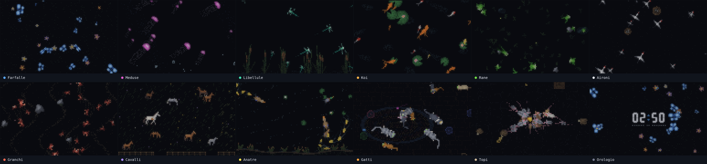

<p align="center"><a href="README.md">English</a> · <b>Italiano</b></p>

<h1 align="center">ASCII Zoo</h1>

<p align="center">
  Animali fatti di caratteri da tastiera che volano, nuotano e saltano intorno a un orologio ASCII.<br>
  Uno sfondo animato per Windows, macOS e Linux (un piccolo programma in Rust; su Windows anche con <a href="https://github.com/rocksdanister/lively">Lively Wallpaper</a>) e una nuova scheda per Firefox.
</p>

<p align="center">
  
</p>

---

## Gli animali

Undici specie, una alla volta, ognuna con il suo ambiente (e sei [paesaggi](#i-paesaggi) senza animali). Di serie lo sfondo passa al successivo ogni 2 minuti, paesaggi compresi; dal menu del programma (**Rotazione**) si sceglie ogni quanto (da 30 secondi a un'ora) e quali animali far girare, oppure la si spegne: **Spenta** tiene lo sfondo che si vede in quel momento (lo stesso che sceglierlo in **Sfondo**). Quando il PC è in carica restano le koi nel loro stagno (si può disattivare).

<p align="center">
  
</p>

| Specie | Come si muove | L'ambiente | Con l'orologio |
|---|---|---|---|
| **Farfalle** | svolazzano a zig-zag battendo le ali | prato visto dall'alto con fiori a cinque petali che ondeggiano, si scostano e si aprono quando una farfalla ci passa vicino; ci si posano sopra | si posano sulle cifre e aprono le ali piano |
| **Meduse** | pulsano e si lasciano portare dalla corrente | fondale con raggi di luce e bolle che salgono: le meduse le spostano, contro l'orologio scoppiano | ci girano intorno |
| **Libellule** | scatti rapidi e pause a mezz'aria | canne con le spighe che salgono da una striscia d'acqua e ondeggiano; le libellule si posano sulle punte, che si piegano | si posano sulle cifre |
| **Koi** | nuotano ondeggiando la coda | stagno con acqua che scorre, ninfee alla deriva e gocce | ci girano intorno; allo scatto del minuto fuggono con un colpo di coda |
| **Rane** | saltano, si fermano, risaltano | prato con ciuffi d'erba, sassi dove si siedono, pozzanghere che schizzano quando ci atterrano, lucciole che scappano (o finiscono mangiate) | ci saltano sopra per sedersi, oppure lo scavalcano |
| **Aironi** | volano tutti nella stessa direzione, con battiti lenti | nidi di rametti con le uova: tornano, chiudono le ali e covano, e dopo un po' le uova si schiudono | ci girano intorno |
| **Granchi** | camminano di lato | sabbia con le increspature e le conchiglie, sassi da aggirare, impronte che il tempo cancella | invertono il passo quando ci arrivano contro |
| **Cavalli** | di profilo, in branco: pascolano, vanno al passo e al trotto; al clic scappano al galoppo alzando la polvere | prateria con l'erba piegata dalle raffiche di vento, fiori di campo, una staccionata in basso | lo aggirano o tornano indietro; allo scatto del minuto quelli vicini partono al galoppo |
| **Anatre** | la mamma nuota a zonzo con gli anatroccoli in fila dietro, ogni tanto mette la testa sott'acqua; qualche maschio da solo | stagno con la riva, le canne e le pannocchie, ninfee che si scostano al passaggio, la scia a V; al clic arriva il pane | ci girano intorno; allo scatto del minuto la mamma scappa e i piccoli le corrono dietro |
| **Gatti** | camminano piano, si siedono a lavarsi e a guardarsi intorno con la coda che batte, ogni tanto uno fa una corsa pazza o va a dare una zampata al gomitolo; dormono acciambellati sui cuscini | salotto visto dall'alto: parquet, un tappeto ovale intrecciato, cuscini, gomitoli che rotolano e lasciano il filo, le tane dei topi nei muri; al clic arriva un topo: i gatti vicini lo rincorrono, lo prendono, ci giocano un po' e lo lasciano andare, finché non trova una tana (se passa vicino a un gatto che dorme, lo sveglia) | ci girano intorno; allo scatto del minuto quelli vicini fanno un balzo |
| **Topi** | corrono a scatti e si fermano ad annusare; vanno a rosicchiare i chicchi caduti | dispensa vista dall'alto: lastre di pietra, sacchi di grano (uno aperto, con la scia di chicchi) e casse da aggirare, una ragnatela in un angolo; al clic arriva uno spicchio di formaggio coi buchi: i topi vicini corrono a mangiarlo tutti intorno, a morsi, e restano le briciole | ci girano intorno; allo scatto del minuto scappano |

Ogni animale è una forma calcolata cella per cella: ogni cella accesa diventa un carattere (`. : - = + * o x X % # & @`), più denso dove il corpo è più pieno, con un leggero bagliore.

**Nomi.** L'animale più grande di ogni specie può avere un nome, scritto sopra la testa una lettera per casella. Di serie ce l'ha solo una koi: **KARPISA**, la carpa che viene da Pisa. Gli altri nomi si danno dal menu del programma.

## I paesaggi

Oltre agli animali, sette paesaggi senza animali: le sette scene dello screensaver, anche come sfondo. Nel menu del programma **Sfondo** ha due sottomenu, **Animali** e **Paesaggi**, e in **In rotazione** si sceglie quali animali e quali paesaggi far girare.

<p align="center">
  
</p>

| Paesaggio | Cosa si vede |
|---|---|
| **Stelle** | si vola tra le stelle: arrivano dal centro, crescono e lasciano una scia; ogni tanto una stella cadente |
| **Pioggia e lampi** | la pioggia col vento, i cerchi e gli schizzi nelle pozzanghere, ogni tanto un fulmine che illumina tutto |
| **Falò** | il fuoco che sale dalla legna incrociata, con le braci che volano su; sta sotto l'orologio |
| **Aurora** | tende di luce verde e viola sopra le montagne, le stelle che brillano, il lago che riflette tutto |
| **Gioco della vita** | le cellule di Conway cambiano colore invecchiando e lasciano una scia; se il mondo si ferma ne arrivano di nuove |
| **Mare di notte** | la luna con i crateri, le nuvole, il riflesso che tremola sulle onde e una barchetta a vela che attraversa |
| **Neve** | una notte d'inverno: nevica a tre profondità con il vento che va e viene, sugli abeti e su una baita con la finestra accesa e il fumo dal camino; un clic è una folata, e vicino a terra la neve si alza in uno sbuffo |

Sono scritti come le [scene tue](#scene-tue): anche loro si trovano come file in `di-serie` e si possono copiare e cambiare.

**Neve durante le feste.** Dal 1° dicembre al 6 gennaio un po' di neve cade su tutti gli sfondi, davanti a tutto ma dietro le parti più luminose degli animali (non sott'acqua con le meduse, non sotto la pioggia e non nel paesaggio Neve, che ha la sua). Si spegne togliendo la spunta a **Neve durante le feste** nel menu.

## I widget

Riquadri di solo testo, nello stesso stile degli animali, in un angolo dello schermo (sopra la barra delle applicazioni). Si accendono dal menu del programma, **Widget**:

```
+- nota -----------------------+   ┌─ sistema ────────────────────┐
| comprare il mangime per      |   │ core   [_.:_*@.:]            │
| KARPISA                      |   │ temp   54°C                  │
+------------------------------+   │ freq   3,20 GHz              │
+- conto alla rovescia --------+   │ ram    9,1 / 16 GB           │
| esame di analisi             |   │ swap   0,2 / 2,0 GB          │
| mancano 12 giorni            |   │ rete   ↓1,2 MB/s ↑33 KB/s    │
+------------------------------+   │ disco  212 / 476 GB          │
+- pc -------------------------+   │ acceso 3 g 4 h               │
| cpu  [##........]  18%       |   │ proc   312                   │
| ram  [######....]  57%       |   │ carico 0,52 0,61 0,70        │
| bat+ [########..]  83%       |   └──────────────────────────────┘
+------------------------------+
```

- **Nota**: una frase che resta sul desktop.
- **Conto alla rovescia**: per cosa e che giorno (`25/12/2026`); il giorno prima dice "domani!", il giorno stesso "è oggi!".
- **CPU, RAM e batteria**, aggiornati ogni 2 secondi (`bat+` = in carica). La batteria c'è solo sui portatili; su macOS la legge IOKit (`IOPSCopyPowerSourcesInfo`).
- **Statistiche per nerd**: un riquadro **sistema** con le righe che spunti. Ogni riga che un sistema non sa dare semplicemente non c'è:
  - **CPU per core**: un carattere per core, più denso quanto più è occupato (`_ . : - = + * # % @`);
  - **Temperatura della CPU** (Linux e macOS; su Windows la darebbe solo WMI con i permessi di amministratore, quindi la voce non c'è) e **frequenza** media dei core;
  - **RAM e swap in GB**, usati su totali;
  - **GPU**: una barra con quanto è occupata, la temperatura e la memoria della scheda video, quando il sistema le dà senza permessi speciali:
    - su **Linux**, NVIDIA con la sua libreria NVML (driver proprietario), AMD con `gpu_busy_percent`, memoria e temperatura da `/sys`, Intel dal tempo che la GPU passa a riposo (RC6). Una GPU dedicata che dorme non si sveglia per leggerla e vale 0%;
    - su **Windows**, gli stessi contatori del Task Manager: si conta il motore più occupato, e la memoria dedicata; la temperatura Windows non la dà;
    - su **macOS**, la percentuale di utilizzo da IOKit (`IOAccelerator`).

    `ascii-zoo --statistiche` scrive tutto quello che il programma legge su quel computer.
  - **Rete**: velocità in arrivo e in uscita delle schede vere (Ethernet, Wi-Fi), senza loopback, VPN e interfacce dei container, che conterebbero due volte lo stesso traffico;
  - **Disco di sistema** (`/` oppure `C:`), usato su totale;
  - **Acceso da** (uptime), numero di **processi** e **carico medio** a 1, 5 e 15 minuti (Linux e macOS: Windows non ce l'ha).

  I valori li legge il crate [sysinfo](https://crates.io/crates/sysinfo), più qualche lettura diretta e leggera (rete su Linux da `/sys`, disco, numero dei processi); solo le voci accese e solo quando almeno uno schermo con lo sfondo non è in pausa. Con tutto acceso costa circa 2 ms di CPU ogni 2 secondi.
- **In riproduzione** (spento di serie): titolo, artista, `▶` o `❚❚` e una barra con il tempo, `[####........] 1:23 / 3:45`, che avanza da sola tra una lettura e l'altra. Quando non suona niente il riquadro sparisce.
  - **Linux**: i lettori che parlano MPRIS (Spotify, Rhythmbox, VLC, Firefox, Chromium…); se ce n'è più d'uno vince quello che suona. Spotify su Linux non dice a che punto è: si vede solo la durata.
  - **Windows**: i controlli multimediali di sistema, gli stessi del riquadro del volume (Spotify, Lettore multimediale, i browser…).
  - **macOS**: da macOS 15.4 il "Now Playing" di sistema non risponde più alle app di terze parti, quindi ASCII Zoo chiede ad AppleScript, e solo a **Musica** e **Spotify**, e solo se sono già aperti (non li avvia mai). La prima volta macOS chiede il permesso **Automazione** per controllarli: serve solo per leggere titolo, artista e posizione. Se lo neghi il riquadro lo dice; si ridà in **Impostazioni di Sistema → Privacy e sicurezza → Automazione**. Gli altri lettori (browser, Podcast…) non si vedono.

  Si legge ogni 2 secondi (su macOS ogni 4) su un thread a parte, solo con il widget acceso e lo sfondo visibile.
- **Pomodoro**, dal menu **Pomodoro** del programma: **Avvia** (poi **Pausa** e **Riprendi**), **Salta fase**, **Ferma**; 25 minuti di lavoro e 5 di pausa oppure 50 e 10, con una pausa lunga (15 o 30 minuti) ogni 4 pomodori, che si può togliere. Il riquadro mostra fase, minuti e secondi che mancano, una barra e a che pomodoro sei; il titolo del menu (e la prima voce, su Linux solo quella) dice quanto manca, al minuto. Finita una fase il programma passa da solo alla successiva: il riquadro lampeggia qualche secondo e dagli animali parte un'onda, senza suoni. Il tempo lo tiene il programma, uno solo per tutti gli schermi: **Ricarica sfondo** non lo azzera, chiudere il programma sì. Le durate restano nelle impostazioni (`pomodoro_lavoro`, `pomodoro_pausa`, `pomodoro_lunga` in minuti, `pomodoro_ogni`).
- **Aspetto**: dimensione (piccoli, normali, grandi), cornice (`+--+` ASCII, `┌──┐` a linee, `╭──╮` arrotondata) e **sfondo pieno** dietro i riquadri, utile quando gli animali passano sotto il testo. Le linee delle cornici non ci sono nel carattere incorporato e le disegna un carattere del sistema, ognuna in una casella larga un carattere: i riquadri restano allineati anche dove quel carattere è più stretto (Consolas su Windows).
- **Posizione**: uno dei quattro angoli; **Schermo**: il principale, uno a scelta o tutti.

Nel browser si vedono con dati di prova aprendo `wallpaper/index.html?widget=demo` (anche con `&cornice=linee`, `&cornice=arrotondata`, `&dimensione=grandi`, `&sfondo=pieno`, `&musica=pausa`, `&pomodoro=pausa`, e `&pomodoro=scatto` per vedere il cambio di fase dopo 3 secondi).

## L'orologio

<p align="center">
  
</p>

- **Sette segmenti** disegnati con gli stessi caratteri degli animali; i segmenti spenti restano appena visibili, come su un display LCD.
- **I due punti** pulsano a ogni secondo nel colore della specie del momento.
- **La data** sta sotto, una lettera per casella.
- **Allo scatto del minuto** le cifre cambiate si ricompongono con un bordo che scintilla, parte un'onda dall'orologio, chi era posato sulle cifre vola via e chi è vicino si spaventa.
- **Chi si posa:** farfalle, libellule e rane, solo le più piccole e al massimo due alla volta, per 4–13 secondi. Gli altri animali girano intorno all'orologio, così l'ora resta sempre leggibile; anche fiori, canne, sassi e nidi stanno lontani dalle cifre.
- **Si può togliere:** voce **Orologio al centro** nel menu del programma (Windows, macOS e Linux). Senza orologio non ci sono né l'ora né la data, gli animali passano anche dal centro e fiori, canne, sassi e nidi possono stare dappertutto. Nel browser si toglie con `index.html?orologio=0`, in Lively con la casella **Orologio al centro** tra le impostazioni dello sfondo.

Le dimensioni si adattano allo schermo: funziona anche in verticale e su schermi piccoli.

<p align="center">
  
</p>

## Tema chiaro e scuro

Di serie lo sfondo è scuro: gli animali sono luce su fondo nero. Il tema **chiaro** li disegna come inchiostro su carta color crema. Non è un negativo: ogni colore tiene la sua tinta e diventa scuro quanto era chiaro sul nero, così quello che spiccava (i corpi degli animali, le cifre) spicca anche sulla carta e quello che era tenue (prato, acqua, sabbia, segmenti spenti) resta vicino al fondo; arancio, rosso e giallo restano vivi. Il bagliore intorno agli animali diventa un alone morbido, come acquerello. Vale per tutte le specie, anche per quelle che verranno, e per i widget.

- **Nel programma:** menu **Tema** → **Scuro**, **Chiaro** oppure **Come il sistema**, che segue il tema chiaro o scuro di Windows (modalità delle app), di macOS (Aspetto, anche "Automatico") o di Linux (le preferenze di aspetto del desktop, su GNOME e KDE) e cambia da solo entro un paio di secondi.
- **Nel browser:** `index.html?tema=chiaro`, `?tema=scuro` oppure `?tema=auto`, che segue il tema del sistema (`prefers-color-scheme`).
- **In Lively:** la tendina **Tema** tra le impostazioni dello sfondo.

## Fotogrammi al secondo

Lo sfondo si muove a **30** fotogrammi al secondo. Dal menu **Fotogrammi al secondo** si può scendere a **20** o **15**: le scene sono lente e si vede poco, mentre CPU e GPU lavorano circa in proporzione meno (a 1920×1080, da 30 a 15: un terzo di CPU in meno). Serve sui portatili. Su Linux con GNOME sotto Wayland lo sfondo è molto più leggero con l'estensione di GNOME che lo script installa (vedi **Wayland** nella sezione Linux): senza, passando da XWayland, con la **scala frazionaria** (125%, 150%…) non va oltre i 20 fotogrammi al secondo e una parte del costo non scende con i fotogrammi. Per capire quanto pesa su un PC Linux c'è [`linux/prestazioni.sh`](linux/prestazioni.sh) (vedi la sezione Linux).

## Foto dello sfondo

Voce **Salva una foto dello sfondo** nel menu del programma (Windows, macOS e Linux): ogni schermo salva un PNG di come appare in quel momento, alla sua risoluzione, con animali, scenografia, orologio e widget. Le foto vanno nella cartella Immagini, sottocartella **ASCII Zoo**, con data e ora nel nome (`ascii-zoo-2026-11-19-031500.png`; con più schermi `…-schermo-1.png`, `…-schermo-2.png`); un file che c'è già non viene mai sovrascritto. Poi il programma la mostra in Esplora risorse, nel Finder o nel gestore dei file di Linux. Uno schermo in pausa dà l'ultimo fotogramma, cioè quello che si vede.

Nel browser la foto si scarica con il tasto **P**.

## Scene tue

Oltre agli animali si possono aggiungere **scene**: uno sfondo senza animali (pioggia, un paesaggio, lucciole…) scritto in un piccolo file JavaScript. Menu **Sfondo** > **Apri la cartella delle scene…** apre la cartella (`%APPDATA%\AsciiZoo\scene` su Windows, `~/Library/Application Support/AsciiZoo/scene` su macOS, `~/.config/AsciiZoo/scene` su Linux). Ogni file `.js` lì dentro diventa una voce in più del menu **Sfondo** (in **Paesaggi**; un file di un animale va in **Animali**); per vederne una nuova si esce da ASCII Zoo e lo si riapre. Per condividere una scena basta mandare il file.

C'è un esempio commentato in [`scene/lucciole.js`](scene/lucciole.js): lucciole sopra l'erba; uno più grande in [`scene/neve.js`](scene/neve.js): la neve che cade e si posa su un paesino di notte, con il vento e le finestre che si accendono. La prima riga `// nome: …` dà il nome nel menu (se manca, il nome del file); il file chiama `scena({ colori, init, tick, disegna })`. `w.put(colonna, riga, intensità, colore, alfa)` accende una cella; `this.c0` è il primo dei colori della scena; `hash2`, `clamp`, `lerp`, `TAU`, `rumore(x, y)` e `frattale(x, y, ottave)` (rumore morbido, per nuvole e onde) e `celle` sono già pronti.

Anche gli animali e i paesaggi sono file: l'app li scrive nella sottocartella `di-serie` (riscritta a ogni avvio). Per cambiarne uno lo si copia nella cartella delle scene: con lo stesso nome (`koi.js`, `aurora.js`) prende il posto di quello di serie, con un nome nuovo (e una nuova riga `// nome:`) è uno sfondo in più nel menu; un animale copiato si comporta come quello da cui viene. I paesaggi sono scritti come le scene, `scena({...})`. I file degli animali sono scritti come il codice di [`wallpaper/index.html`](wallpaper/index.html): `SPECIES.push({...})` per l'animale, `SCENES.x = {...}` per il suo sfondo.

Le scene sono codice scritto da altri: nell'app la pagina dello sfondo non può usare la rete né aprire altre pagine, e una scena che va in errore smette di disegnare senza fermare il resto. Funzionano solo nel programma, non nella versione per il browser.

## Struttura

```
ascii-zoo/
├── wallpaper/               sfondo animato (anche pronto per Lively Wallpaper)
│   ├── index.html           tutto in un file: motore, orologio, carattere incorporato
│   ├── LivelyInfo.json      descrizione del pacchetto per Lively
│   ├── LivelyProperties.json  impostazioni in Lively (orologio al centro, neve durante le feste, tema)
│   └── thumbnail.jpg        miniatura nella libreria di Lively
├── app/                     programma in Rust per Windows, macOS e Linux
│   ├── src/                 finestre dietro le icone, menu, nomi, rotazione, pause
│   ├── assets/              copia di wallpaper/index.html incorporata nell'eseguibile
│   ├── macos/               Info.plist dell'app per macOS
│   └── build.rs, app.manifest   aspetto moderno della finestrella dei nomi
├── dreams/                  screensaver per Windows e macOS (su Linux lo lancia l'app): motore nativo con 6 scene (stelle, pioggia, fuoco…)
│   ├── src/scenes/          una scena per file
│   └── macos/               il modulo per macOS (ASCII Zoo.saver)
├── linux/                   install.sh (installazione con un comando), prestazioni.sh (misure) e l'icona
│   └── gnome/               estensione di GNOME Shell: sfondo senza XWayland e clic sul desktop
├── scene/                   scene di esempio da mettere nella cartella delle scene (lucciole.js, neve.js)
├── firefox/                 estensione "nuova scheda" per Firefox
│   ├── manifest.json
│   ├── index.html, app.js, zoo.js, style.css, icon.svg
│   ├── fonts/               IBM Plex Mono (SIL OFL 1.1)
│   └── README.txt
└── docs/                    immagini di questo README
```

## Sfondo animato per Windows

### Con il programma in Rust (consigliato)

La cartella `app/` contiene un programma che mette lo sfondo dietro le icone su tutti i monitor, senza bisogno di Lively. Si configura tutto dall'icona a forma di koi nell'area di notifica (vicino all'orologio di Windows), con un clic destro:

- **Sfondo**: a rotazione oppure uno fisso, dal sottomenu **Animali** o **Paesaggi** (anche le [scene tue](#scene-tue)), e in **In rotazione** quali sfondi far girare. Con più monitor queste voci stanno in **Tutti gli schermi**, e ogni schermo ha un sottomenu uguale: uno sfondo diverso su ognuno (koi sul portatile, aurora sull'altro…) e, se vuoi, i suoi sfondi in rotazione;
- **Rotazione**: ogni quanto cambia sfondo (o **Spenta**, per tenere quello di adesso);
- **Nomi degli animali**: il nome dell'animale più grande di ogni specie;
- **Widget**: nota, conto alla rovescia, CPU/RAM/batteria, statistiche per nerd, in riproduzione, aspetto dei riquadri (vedi [I widget](#i-widget));
- **Pomodoro**: lavoro e pause a tempo, con il conto alla rovescia in un riquadro (vedi [I widget](#i-widget));
- **Tema**: scuro, chiaro oppure come il sistema (vedi [Tema chiaro e scuro](#tema-chiaro-e-scuro));
- **Salva una foto dello sfondo**: un PNG per schermo nella cartella Immagini (vedi [Foto dello sfondo](#foto-dello-sfondo));
- **Orologio al centro**: togliendo la spunta l'orologio sparisce e lo schermo è tutto per gli animali;
- **Clic sul desktop agli animali**: un clic in una zona vuota del desktop dà da mangiare alle koi e alle anatre, fa uscire un topo per i gatti, dà il formaggio ai topi o fa scappare gli altri animali, come nel browser;
- le pause (a batteria, con app a schermo intero, quando le finestre coprono il desktop; le stesse voci anche su macOS e Linux), l'avvio con Windows;
- **Screensaver**: la scena (stelle, pioggia e lampi, falò, aurora, gioco della vita, mare di notte, oppure tutte una dopo l'altra), **Prova adesso** e **Attiva come screensaver di Windows…**, che apre le impostazioni dello screensaver di Windows con ASCII Zoo già scelto (lì decidi dopo quanto parte). Lo screensaver è lo stesso exe, copiato come `%LOCALAPPDATA%\AsciiZoo\ascii-zoo.scr`, con un motore nativo senza WebView (cartella [`dreams/`](dreams/)).

Le voci con la spunta si applicano subito e il menu resta aperto, nello stesso sottomenu, così se ne cambiano diverse di fila (lo sfondo cambia già mentre il menu è aperto); si chiude cliccando fuori o con Esc. Le voci con "…", che aprono una finestrella, e **Salva una foto dello sfondo**, **Ricarica sfondo**, **Esci** e **Avvia**, **Salta fase**, **Ferma** del pomodoro lo chiudono.

#### Scaricarlo

Dalla pagina [**Releases**](https://github.com/ascii-things/ascii-zoo/releases/latest) scarica `ascii-zoo.exe` (Windows 10/11, 64 bit). Non si installa: copialo in una cartella fissa, per esempio `%LOCALAPPDATA%\AsciiZoo`, e avvialo da lì, perché **Avvia con Windows** ricorda il percorso. Serve WebView2, già presente su Windows 11 e su Windows 10 aggiornato.

- **Da dove viene l'exe.** Non è mai nella repo: lo compila GitHub Actions dal sorgente del tag della versione ([`.github/workflows/build.yml`](.github/workflows/build.yml)), e il log della build è pubblico. Ogni Release riporta l'SHA256 dell'exe e ha l'attestazione di provenienza di GitHub. Per controllarli:
  ```powershell
  Get-FileHash .\ascii-zoo.exe -Algorithm SHA256
  gh attestation verify .\ascii-zoo.exe --repo ascii-things/ascii-zoo
  ```
- **"Windows ha protetto il PC".** L'exe non è firmato, quindi al primo avvio SmartScreen lo blocca: **Ulteriori informazioni → Esegui comunque**.
- **Aggiornare.** Quando esce una versione nuova, in cima al menu compare **È uscita la versione…: scaricala…**, che apre la pagina per scaricarla (l'app lo chiede a GitHub una volta al giorno, e manda solo la richiesta con il nome e la versione del programma; non scarica e non installa niente da sola). Scarica l'exe nuovo e avvialo, anche da un'altra cartella: chiude da solo la versione che sta girando (che rimette lo sfondo di Windows) e prende il suo posto. Se **Avvia con Windows** è attivo, da quel momento all'accesso parte il nuovo. L'exe vecchio non lo cancella, perché l'hai messo tu: se è in un'altra cartella toglilo a mano.
- **Cosa tocca sul PC.** Scrive solo `%APPDATA%\AsciiZoo\config.json` (le impostazioni), le foto che chiedi (in Immagini\ASCII Zoo) e, se attivi **Avvia con Windows**, due cose: un'attività pianificata **ASCII Zoo** (Utilità di pianificazione) che lo avvia appena entri in Windows, senza i secondi che Windows fa aspettare ai programmi di avvio, e, come riserva, il valore `AsciiZoo` nella chiave `HKCU\Software\Microsoft\Windows\CurrentVersion\Run` (che compare anche in **Impostazioni → App → Avvio**). Partono tutte e due con `--accesso`: la seconda vede che lo sfondo c'è già e si chiude. Una versione nuova le fa puntare a sé. Per spegnere l'avvio togli la spunta dal menu: spegnerlo solo da **App → Avvio** lascia l'attività. Lo sfondo è dentro l'exe. Si collega a internet solo una volta al giorno, per chiedere a GitHub se c'è una versione nuova (vedi **Aggiornare**; si spegne togliendo la spunta a **Avvisa quando esce una versione nuova**). Per **Clic sul desktop agli animali** usa un hook del mouse di Windows (`WH_MOUSE_LL`): legge solo dove si preme il tasto sinistro, lascia sempre passare il clic e non registra niente; si spegne togliendo la spunta dal menu. Un programma non firmato che si aggancia al desktop e si mette in avvio automatico può far scattare qualche antivirus.
- **Senza eseguire niente.** Lo sfondo è solo HTML: `wallpaper/index.html` si apre in qualsiasi browser (vedi sotto).

Per compilarlo da sé: [`app/README.md`](app/README.md).

### Con Lively Wallpaper

Serve [Lively Wallpaper](https://www.rocksdanister.com/lively/) (gratuito, anche dal Microsoft Store).

**Dall'app.** In Lively aggiungi un nuovo sfondo con il pulsante **+**, scegli il file `wallpaper/index.html` e applicalo. Con più schermi puoi applicarlo a ognuno.

**Da riga di comando** (provato con Lively 2.5.6 dal Microsoft Store):

1. Copia la cartella `sfondo` nella libreria di Lively, con un nome a scelta (es. `asciizoo`). Per la versione Store la libreria è
   `%LOCALAPPDATA%\Packages\12030rocksdanister.LivelyWallpaper_97hta09mmv6hy\LocalCache\Local\Lively Wallpaper\Library\wallpapers\`
2. Con Lively aperto, applicalo indicando la cartella come la vede Lively (percorso virtualizzato, senza `Packages\…\LocalCache\Local`):
   ```
   Lively.exe setwp --file "%LOCALAPPDATA%\Lively Wallpaper\Library\wallpapers\asciizoo" --monitor 1
   ```
   Ripeti con `--monitor 2`, `--monitor 3` per gli altri schermi. `Lively.exe` è nella cartella `Build` dell'app, sotto `C:\Program Files\WindowsApps\12030rocksdanister.LivelyWallpaper_…`.

Da riga di comando Lively accetta solo una cartella con `LivelyInfo.json`: un `.html` passato da solo viene rifiutato ("Unsupported command import file").

### Provarlo nel browser

Apri `wallpaper/index.html` in un browser qualsiasi. Aggiungendo il nome di una specie dopo `#` resta fissa quella, senza cambio ogni 2 minuti:

```
index.html#koi      index.html#meduse      index.html#granchi
```

Nel browser un clic sullo sfondo fa disperdere gli animali; con le koi e le anatre invece fa cadere del cibo, con i gatti arriva un topo e con i topi un pezzo di formaggio.

### Note

- **Prestazioni.** Lo sfondo è limitato a 30 fotogrammi al secondo, scanditi da un timer (non da `requestAnimationFrame`, che sveglierebbe la pagina a ogni aggiornamento dello schermo), e a ogni fotogramma ridisegna solo le celle cambiate: di solito una su dieci. Data e nomi stanno su un canvas a parte, ridisegnato solo quando cambiano. Il programma in Rust ferma l'animazione quando nessuno la vede: su Windows a batteria, con un'app a schermo intero e quando le finestre coprono tutto il desktop di uno schermo; su macOS e Linux come spiegato nelle loro sezioni. Lively la ferma quando una finestra copre il desktop. Con `prefers-reduced-motion` gli animali vanno più piano.
- **La schermata di blocco** di Windows accetta solo immagini fisse: lì si può mettere uno screenshot dello sfondo.
- **Il desktop non risponde ai clic con Lively?** Su Windows 11 può succedere dopo che uno schermo si scollega e si ricollega. Basta riavviare Lively: icona nell'area di notifica → Esci, poi riaprilo dal menu Start.

## Sfondo animato per macOS

Lo stesso programma esiste per macOS 11 o successivo, su Mac con Apple Silicon e Intel. Dalla pagina [**Releases**](https://github.com/ascii-things/ascii-zoo/releases/latest) scarica `ascii-zoo-macos.dmg`, aprilo e trascina **ASCII Zoo** in **Applicazioni**.

- Lo sfondo copre ogni schermo sopra l'immagine del desktop e sotto le icone del Finder, in tutti gli Spazi. Il menu è l'icona a forma di koi nella **barra dei menu**, con le stesse voci della versione Windows (al posto di "Avvia con Windows" c'è **Apri al login**).
- **Pause.** Lo sfondo si ferma a batteria e, schermo per schermo, quando non si vede: finestre che coprono tutto il desktop, un'app a schermo intero, schermo bloccato o spento. Lo dice macOS stesso (lo stato di occlusione della finestra), senza controlli a parte; riparte entro mezzo secondo da quando torna visibile. Come su Windows, nel menu ci sono le voci **Pausa con app a schermo intero** e **Pausa quando le finestre coprono il desktop**, che si possono spegnere una per una.
- **Barra dei menu e Dock.** I widget restano fuori dalla barra dei menu e dal Dock, anche se lo sposti o lo nascondi.
- **Clic sul desktop.** Un clic sul desktop, anche sulle icone del Finder, dà da mangiare alle koi e alle anatre, fa uscire un topo per i gatti, dà il formaggio ai topi o fa scappare gli altri animali. Usa un monitor globale dei clic di macOS (`NSEvent`): vede solo dove si preme il tasto sinistro nelle altre app, non blocca né cambia il clic, non registra niente e non chiede il permesso Accessibilità (serve solo per i tasti). Il clic vale solo se nel punto non c'è nessuna finestra, il Dock o la barra dei menu. Si spegne togliendo la spunta a **Clic sul desktop agli animali**.
- **In riproduzione.** Il widget, spento di serie, chiede a Musica e Spotify cosa suonano (solo se sono aperti): la prima volta macOS chiede il permesso **Automazione** (vedi [I widget](#i-widget)). Dato che l'app non è firmata con un certificato Apple, dopo un aggiornamento macOS può chiederlo di nuovo.
- **Screensaver.** Le sei scene dello screensaver di Windows (stelle, pioggia, falò, aurora, gioco della vita, mare di notte) ci sono anche qui, come modulo di macOS. Nel menu **Screensaver** scegli la scena (o tutte, una dopo l'altra), **Prova adesso** lo mostra subito a tutto schermo (si chiude toccando mouse o tastiera) e **Attiva come screensaver di macOS…** copia `ASCII Zoo.saver` in `~/Library/Screen Savers` e apre le impostazioni del salvaschermo (su macOS 26 sono dentro **Sfondo**), dove scegli **ASCII Zoo** e dopo quanto parte. macOS fa girare i salvaschermo in una sandbox: il modulo prova a leggere la scena scelta da `~/Library/Application Support/AsciiZoo/screensaver.json`, dove la scrive l'app, e di solito la sandbox lo lascia fare; se non può, le scene girano tutte a rotazione. **Prova adesso** è lo stesso modulo, caricato dall'app, e mostra sempre la scena scelta. Dopo un aggiornamento dell'app, al primo avvio si aggiorna anche il modulo, se è installato. Da macOS 14 il processo dei salvaschermo di macOS può restare acceso anche dopo: quando il salvaschermo finisce, il modulo lo chiude.
- **"Impossibile aprire l'app".** L'app non è firmata con un certificato Apple, quindi al primo avvio macOS la blocca: apri **Impostazioni di Sistema → Privacy e sicurezza** e premi **Apri comunque**, poi conferma.
- **Aggiornare.** Quando esce una versione nuova lo dice la prima voce del menu, come su Windows. Trascina la versione nuova in **Applicazioni** (sostituendo la vecchia) e aprila: chiude da sola quella che sta girando, anche se veniva da un'altra cartella, e prende il suo posto; se **Apri al login** è attivo, da quel momento all'accesso parte la nuova. Una .app vecchia in un'altra cartella non la cancella: toglila tu. **Apri al login** si attiva solo con l'app in una cartella fissa (non aperta direttamente dal DMG).
- **Da dove viene il DMG e cosa tocca**: come per Windows, lo compila GitHub Actions, ha SHA256 e attestazione (`gh attestation verify ascii-zoo-macos.dmg --repo ascii-things/ascii-zoo`), scrive solo `~/Library/Application Support/AsciiZoo/config.json`, le foto che chiedi (in `~/Pictures/ASCII Zoo`), se attivi **Apri al login**, `~/Library/LaunchAgents/io.github.tressilloide.asciizoo.plist` `screensaver.json` accanto se scegli una scena dello screensaver e, se scegli **Attiva come screensaver di macOS…**, `~/Library/Screen Savers/ASCII Zoo.saver` (lo sostituisce solo se è il suo: un modulo di altri con lo stesso nome non lo tocca). Si collega a internet solo una volta al giorno, per chiedere a GitHub se c'è una versione nuova (vedi **Aggiornare**; si spegne togliendo la spunta a **Avvisa quando esce una versione nuova**).
- **Toglierla.** Togli la spunta ad **Apri al login**, scegli **Esci** e trascina **ASCII Zoo** dalle Applicazioni nel Cestino. Se usavi lo screensaver, nelle impostazioni del salvaschermo scegline un altro e cancella solo `ASCII Zoo.saver` da `~/Library/Screen Savers` (nel Finder: **Vai → Vai alla cartella…**). Le impostazioni sono in `~/Library/Application Support/AsciiZoo`, se vuoi togliere anche quelle.

## Sfondo animato per Linux

Si installa con un solo comando nel terminale:

```
curl -fsSL https://raw.githubusercontent.com/ascii-things/ascii-zoo/main/linux/install.sh | bash
```

Se preferisci leggere lo script prima di eseguirlo, lo stesso da un clone della repo:

```
git clone https://github.com/ascii-things/ascii-zoo.git && bash ascii-zoo/linux/install.sh
```

Lo script ([`linux/install.sh`](linux/install.sh)) mette il programma nella tua cartella utente:

1. scarica il programma già compilato dall'ultima [Release](https://github.com/ascii-things/ascii-zoo/releases/latest), per processori x86_64 o aarch64, e ne controlla lo SHA256. Lo compila GitHub Actions su Ubuntu 22.04, quindi va anche sulle distribuzioni più nuove;
2. installa con **apt** (Ubuntu, Debian, Mint), **dnf** (Fedora) o **pacman** (Arch) le librerie per farlo partire (WebKitGTK 4.1, GTK 3, AppIndicator, libxdo, zenity), solo se mancano; chiede la password di `sudo` solo per questo;
3. come riserva lo compila dal sorgente: se l'ultima Release non ha ancora il programma per Linux (fino alla 0.4.0 non c'era), per un altro processore, o se quello scaricato non parte. Installa allora le librerie per compilarlo, Rust con rustup se manca (in `~/.cargo`, senza toccare il `PATH`) e compila (la prima volta qualche minuto). Con `bash linux/install.sh --compila` compila sempre, dal clone in cui si trova lo script;
4. lo copia in `~/.local/bin/ascii-zoo` al posto della versione di prima (che ferma), aggiunge icona e voce **ASCII Zoo** nel menu delle applicazioni, lo fa partire all'accesso e lo avvia;
5. su GNOME 45 o successivo mette la piccola estensione di GNOME Shell che mette lo sfondo al posto di quello di GNOME senza passare da XWayland (molto più leggero) e passa ad ASCII Zoo i clic sul desktop (vedi sotto);
6. se trova una versione vecchia fatta come estensione di GNOME Shell (uuid `ascii-zoo…@…`), la spegne e la toglie, così non girano due sfondi uno sopra l'altro. Se ce n'è anche una copia di sistema per la schermata di accesso (in `/usr/share/gnome-shell/extensions`, attivata da un file in `/usr/share/gdm/dconf`), la toglie con `sudo`. Lo fa solo dopo che la versione nuova è compilata e installata.

L'icona a forma di koi compare **nella barra in alto**, con lo stesso menu delle altre versioni (al posto di "Avvia con Windows" c'è **Apri al login**). Quando esce una versione nuova lo dice la prima voce del menu, come su Windows. Per aggiornare si rilancia lo stesso comando (se ha compilato, il codice resta in `~/.cache/ascii-zoo` e la volta dopo si compila molto più in fretta). Anche avviando a mano una copia nuova, quella che sta girando si chiude e la nuova prende il suo posto (e **Apri al login**, se attivo, passa alla nuova). Per togliere tutto:

```
curl -fsSL https://raw.githubusercontent.com/ascii-things/ascii-zoo/main/linux/install.sh | bash -s -- --disinstalla
```

- **Da dove viene il programma.** Come per Windows e macOS lo compila GitHub Actions dal sorgente del tag della versione, con il log pubblico; ogni Release riporta lo SHA256 del pacchetto (lo script lo controlla da sé) e ha l'attestazione di provenienza: `gh attestation verify ascii-zoo-linux-x86_64.tar.gz --repo ascii-things/ascii-zoo`. Il pacchetto contiene il programma, l'icona e l'estensione di GNOME.
- **Se apt si ferma** con `unmet dependencies`: su Ubuntu capita dopo un aggiornamento di versione, quando un pacchetto resta a una build poi ritirata dall'archivio (per esempio `libbz2-1.0 1.0.8-6ubuntu0.1`) e il suo `-dev` chiede la versione dell'archivio. Lo script lo riconosce, simula il downgrade dei pacchetti interessati e, se non toglie niente, stampa il comando da lanciare; il downgrade non lo fa da solo, perché se trascinasse via altri pacchetti potrebbe togliere il desktop.
- **Ubuntu** mostra le icone nella barra in alto di serie (estensione *Ubuntu AppIndicators*). Su GNOME senza Ubuntu (Fedora, Debian…) serve l'estensione *AppIndicator and KStatusNotifierItem Support*: lo script avvisa se manca.
- **Wayland.** Wayland non permette a un programma normale di mettersi al posto dello sfondo. Su **GNOME 45 o successivo** (Ubuntu 23.10 e seguenti, Fedora 39 e seguenti…) lo script mette allora una piccola estensione di GNOME Shell, [`zoo-click@tressilloide.github.io`](linux/gnome/zoo-click@tressilloide.github.io/sfondo.js), che lo fa per ASCII Zoo: l'app apre per ogni schermo una finestra Wayland normale, e l'estensione la minimizza appena compare e ne mostra il contenuto dentro lo sfondo di GNOME, sotto tutte le finestre e le icone del desktop (anche nella panoramica), e la toglie da Alt+Tab, dalla panoramica e dalla dash. Così ogni fotogramma resta sulla GPU: senza l'estensione ASCII Zoo passa da XWayland (`GDK_BACKEND=x11`, una finestra di tipo "desktop"), dove GTK 3 deve copiare ogni fotogramma in memoria e XWayland ricaricarlo sulla GPU. Misurato su un portatile (Intel Core i7-8550U con grafica UHD 620, Ubuntu 26.10 con GNOME 51, schermo 1920×1080 al 125%), sommando la CPU di ASCII Zoo, WebKitGTK, GNOME Shell e Xwayland:

  | | con l'estensione | XWayland |
  |---|---|---|
  | 30 fotogrammi al secondo | 0,83 core, 30 fotogrammi veri | 1,26 core, solo 14 fotogrammi |
  | 15 fotogrammi al secondo | 0,49 core | 1,17 core, solo 10 fotogrammi |

  GNOME carica le estensioni nuove solo all'accesso: dopo l'installazione o un aggiornamento lo sfondo passa da XWayland fino al prossimo accesso (esci e rientra), poi da solo senza. Se l'estensione si spegne (dall'app **Estensioni**, o se GNOME la scarta) ASCII Zoo torna da solo su XWayland entro pochi secondi; se la riaccendi, al prossimo avvio di ASCII Zoo è di nuovo senza XWayland. Prende solo una finestra con il titolo giusto (`@ascii-zoo-sfondo!…`) il cui programma è proprio `ascii-zoo`. Con altri desktop (KDE, XFCE…) e sotto X11 resta la finestra di tipo "desktop", come prima. In entrambi i modi i clic attraversano lo sfondo e arrivano alle icone del desktop. Lo screensaver passa sempre da XWayland.
- **Clic sul desktop.** Sotto Wayland un programma normale non vede i clic fatti sulle altre finestre, e su Ubuntu le icone del desktop (DING) stanno in una finestra a tutto schermo sopra lo sfondo. Ci pensa la stessa estensione di GNOME ([`extension.js`](linux/gnome/zoo-click@tressilloide.github.io/extension.js)): quando premi il tasto sinistro sul desktop (anche sopra le icone di DING; non sulle finestre, sulla barra in alto o per chiudere un menu) passa il punto ad ASCII Zoo, che dà da mangiare alle koi o fa scappare gli altri animali. Non blocca né cambia il clic e non registra niente. GNOME carica le estensioni nuove solo all'accesso, quindi **funziona dal prossimo accesso**. Lavora solo mentre ASCII Zoo è acceso con **Clic sul desktop agli animali** spuntato, e si ferma quando non tocchi mouse e tastiera per 2 secondi. Con altri desktop o con GNOME più vecchio il clic sul desktop non c'è; lo sfondo funziona lo stesso.
- **Menu dell'icona su GNOME.** Lo disegna GNOME Shell, e i sottomenu si aprono dentro il menu: con tutte le voci di ASCII Zoo a un sottomenu restavano poche righe e si scorreva una voce alla volta. La stessa estensione ([`menu.js`](linux/gnome/zoo-click@tressilloide.github.io/menu.js)), solo nel menu di ASCII Zoo, nasconde le altre voci mentre un sottomenu è aperto, che così si vede tutto; richiudendolo tornano.
- **Cosa tocca:** `~/.local/bin/ascii-zoo`, `~/.local/share/applications/ascii-zoo.desktop`, l'icona in `~/.local/share/icons`, `~/.config/autostart/ascii-zoo.desktop`, le impostazioni in `~/.config/AsciiZoo/config.json`, le foto che chiedi (nella cartella Immagini, sottocartella `ASCII Zoo`) e, su GNOME, l'estensione in `~/.local/share/gnome-shell/extensions/zoo-click@tressilloide.github.io` (aggiunta a quelle attive, `enabled-extensions`); toglie solo le estensioni GNOME `ascii-zoo…@…` delle versioni vecchie (vedi il punto 6). Si collega a internet solo una volta al giorno, per chiedere a GitHub se c'è una versione nuova (vedi **Aggiornare**; si spegne togliendo la spunta a **Avvisa quando esce una versione nuova**).
- **Pause.** Lo sfondo si ferma a batteria, con lo schermo bloccato o spento (salvaschermo di GNOME, o quello standard di KDE e altri desktop) e, su GNOME, quando non si vede. Con l'estensione di GNOME, schermo per schermo, come su Windows e macOS: un'app a schermo intero (voce **Pausa con app a schermo intero**) o finestre che coprono tutta l'area di lavoro (voce **Pausa quando le finestre coprono il desktop**, anche solo una finestra massimizzata), che l'estensione dice ad ASCII Zoo appena cambiano; riparte subito quando torna visibile. Su XWayland invece si accorge solo di un'app a schermo intero che lo copre del tutto: GNOME rallenta i fotogrammi delle finestre che non si vedono e ASCII Zoo se ne accorge. Le finestre solo massimizzate non bastano, perché la barra in alto resta visibile. Riparte entro un paio di secondi da quando torna visibile, e un'app a schermo intero la vede entro una ventina di secondi: per accorgersene ASCII Zoo misura il ritmo dei fotogrammi per mezzo secondo ogni 10 secondi (ogni 2 quando lo sfondo è coperto), non sempre, perché misurare fa ridisegnare tutta la finestra. Nel menu ci sono le stesse voci di Windows e macOS, ma qui un'app a schermo intero e le finestre che coprono lo sfondo non si distinguono: basta una delle due voci accesa. Animarlo quando non si vede costerebbe CPU e GPU per niente: sotto Wayland ogni fotogramma passa da XWayland.
- I widget ci sono tutti, con CPU, RAM e batteria lette da `/proc` e `/sys`.
- **Se va lento o consuma troppo:** `bash linux/prestazioni.sh` (oppure `curl -fsSLo prestazioni.sh https://raw.githubusercontent.com/ascii-things/ascii-zoo/main/linux/prestazioni.sh && bash prestazioni.sh`) misura per circa due minuti la CPU di ASCII Zoo, di WebKitGTK, di GNOME Shell e di Xwayland, e quanti fotogrammi fa davvero lo sfondo: con l'app chiusa, normale, su XWayland per confronto (se normale era senza XWayland) e con WebKitGTK tutto in software. Scrive in `~/ascii-zoo-prestazioni.txt` un rapporto con scheda video, driver, schermi, se l'estensione di GNOME è accesa e le impostazioni che contano (mai la nota o i nomi), da allegare a una segnalazione. Alla fine l'app riparte come prima.
- **Screensaver.** GNOME non ha più un modo per aggiungere gli screensaver di altri programmi, quindi lo fa partire ASCII Zoo stesso. Nel menu **Screensaver** scegli dopo quanti minuti senza toccare mouse e tastiera deve partire (di serie è **spento**: un aggiornamento non lo accende da solo), la scena (stelle, pioggia e lampi, falò, aurora, gioco della vita, mare di notte, oppure tutte una dopo l'altra) e **Prova adesso**. Sono le stesse scene dello screensaver di Windows, con l'orologio, su tutti gli schermi, a 30 fotogrammi al secondo (15 a batteria); intanto lo sfondo è in pausa.
  - **Si vede solo se parte prima che GNOME spenga lo schermo**: il suo ritardo deve essere più corto di quello di **Impostazioni > Energia > Schermo vuoto** (di serie 5 minuti). Nel menu, sotto i minuti, c'è scritto dopo quanto GNOME spegne lo schermo. Non blocca il PC: per quello resta il blocco dello schermo di GNOME.
  - Si chiude al primo movimento del mouse, tasto o clic. Non parte se un video o un'altra app ha chiesto di non andare in inattività, con lo schermo bloccato e, su GNOME, sopra un'app a schermo intero: se ne accorge come per la pausa dello sfondo, quindi non a batteria con **Pausa a batteria** accesa (lì contano solo le app che chiedono di non andare in inattività, come i video e quasi tutti i giochi). Se il motivo passa mentre non stai ancora usando il PC, parte allora. Si chiude da solo quando lo schermo si blocca o si spegne.
  - Da quanto non usi il PC lo chiede a GNOME (il monitor di inattività di mutter), e GNOME gli dice anche quando torni: così si chiude anche se la sua finestra non ha il focus. Su KDE e sugli altri desktop che rispondono a `org.freedesktop.ScreenSaver.GetSessionIdleTime` lo chiede ogni 2 secondi. Dove non c'è nessuno dei due le voci dei minuti restano grigie e c'è solo **Prova adesso**.
  - È lo stesso programma, lanciato come `ascii-zoo --salvaschermo`; con `ascii-zoo --salvaschermo --finestra --scena aurora` lo provi in una finestra (Esc chiude). Le scelte vanno in `config.json`, insieme alle altre: nessun file in più.

## Nuova scheda per Firefox

La cartella `firefox/` è un'estensione che mostra gli animali in ogni nuova scheda, con saluto, ora e una barra di ricerca. È la versione precedente del motore: niente orologio ASCII e niente animali che si posano.

**Provarla subito** (resta attiva fino alla chiusura di Firefox):

1. Apri `about:debugging#/runtime/this-firefox`.
2. Premi **Carica componente aggiuntivo temporaneo…** e scegli `firefox/manifest.json`.
3. Apri una nuova scheda.

**Tenerla per sempre.** Firefox installa in modo permanente solo estensioni firmate da Mozilla:

- firma gratuita per uso personale: comprimi il *contenuto* della cartella `firefox/` in uno zip (con `manifest.json` alla radice) e caricalo su [addons.mozilla.org/developers](https://addons.mozilla.org/developers/) scegliendo la distribuzione "per conto proprio". Ricevi un `.xpi` firmato da trascinare in Firefox;
- oppure, con Firefox Developer Edition o ESR, imposta `xpinstall.signatures.required` su `false` in `about:config` e installa lo zip da `about:addons` → ingranaggio → **Installa componente aggiuntivo da file**.

**Uso.** Clic sullo sfondo: gli animali si disperdono (le koi ricevono cibo). Tasti `1`–`7` cambiano animale, `H` nasconde l'interfaccia, `/` va alla ricerca. L'ingranaggio in basso a destra permette di impostare il nome per il saluto e il cambio automatico.

## Crediti

Carattere [IBM Plex Mono](https://github.com/IBM/plex), © IBM Corp., licenza SIL Open Font License 1.1 (`firefox/fonts/OFL.txt`). Nello sfondo è incorporato direttamente in `index.html`.

## Licenza

Il codice è sotto licenza [MIT](LICENSE). Il carattere IBM Plex Mono resta sotto la sua licenza SIL Open Font License 1.1 (vedi [NOTICE](NOTICE)).
