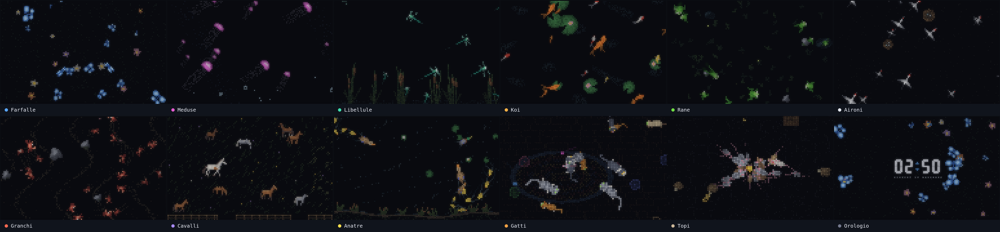

<p align="center"><b>English</b> · <a href="README.it.md">Italiano</a></p>

<h1 align="center">ASCII Zoo</h1>

<p align="center">
  <b>A living ASCII aquarium on your desktop.</b><br>
  Koi, jellyfish, butterflies, frogs and more, all made of text characters, swimming, flying and hopping behind your icons.
</p>

<p align="center">
  <a href="https://github.com/ascii-things/ascii-zoo/releases/latest"></a>
  
  
  <a href="LICENSE"></a>
</p>

<p align="center">
  
</p>

<p align="center"><i>Click anywhere on the desktop and the koi rush to the food.</i></p>

---

## Why

Animated wallpapers are fun, but the apps that run them are often heavy, closed source or tied to a single OS.
We wanted the opposite: a **tiny, fast, open-source** live wallpaper that looks good on any desktop.

- **Light.** Under 1 MB on Windows, capped at 30 fps and redrawing only the cells that change (usually about 1 in 10). It pauses on battery and whenever nobody can see it (fullscreen apps, covered desktop, locked screen; details per OS in the [Italian README](README.it.md)).
- **Private.** No telemetry, no account. The only thing it asks the internet is, once a day, whether a new version is out (you can switch it off). The whole wallpaper is a single HTML file built into the app.
- **Open.** MIT licensed, built in public, with every release compiled by GitHub Actions from the tagged source.

## Built fast, with AI

ASCII Zoo went from a browser toy to a cross-platform desktop app in a few days.
We wrote it with AI coding assistants as pair programmers: we decided what to build and how it should feel, the AI helped
with the low-level parts (Win32 desktop layering, macOS window levels, Linux tray icons, CI and signed-provenance releases),
and we checked the result on our own desktops, while CI builds every platform and launches and screenshots the app on macOS and Linux at each push.
It's a small example of what two people and an AI can ship together in a short time. Every line is here to read.

## Features

<p align="center">
  
</p>

- **11 species, 11 worlds.** Butterflies on a flower meadow, jellyfish among rising bubbles, dragonflies on reeds, koi in a pond with lily pads, frogs and fireflies, herons with nests that hatch, crabs on the sand, a herd of horses on a windswept prairie, a mother duck leading her ducklings across a pond (click to throw them bread), cats in a living room that nap curled up on cushions and bat at balls of yarn (click and a mouse runs out: the cats chase it, catch it, play with it and let it go, until it finds a hole in the wall), mice in a pantry darting between sacks and crates (click to give them a piece of cheese: they all gather round and nibble it away). They rotate automatically (menu **Rotazione**: how often, which ones, or **Spenta** to keep the one on screen), or you pick one.
- **7 landscapes, no animals**: a starfield to fly through, rain with lightning, a campfire, the aurora over mountains and a lake, the Game of Life, a night sea with the moon and a little sailboat, a snowy winter night with fir trees and a cabin (click for a gust of wind). They are the screensaver's seven scenes, as wallpapers too. In the tray menu, **Sfondo** (wallpaper) has two submenus: **Animali** and **Paesaggi**.
- **Snow for the holidays**: from December 1st to January 6th a little snow falls over every wallpaper (not underwater, not in the rain). Untick **Neve durante le feste** in the menu to turn it off.
- **An ASCII clock** they interact with: butterflies land on the digits, koi flee when the minute ticks over. Don't want it? Untick **Orologio al centro** (clock in the middle) in the menu, or open `index.html?orologio=0` in the browser.
- **Click the desktop** to feed the koi and ducks, let a mouse out for the cats, give the mice some cheese, or scatter the other animals (Windows, macOS, and Linux with GNOME 45+ through a tiny GNOME Shell extension, since Wayland doesn't let apps see clicks on other windows).
- **Light on Linux too.** Wayland doesn't let a normal app become the wallpaper. On GNOME 45+ the same extension does it: the app opens a plain Wayland window, the extension minimizes it and shows its content inside GNOME's own background (desktop and overview), hidden from Alt+Tab and the dash, so every frame stays on the GPU. Without it the app falls back to XWayland, where GTK 3 has to copy every frame through memory: on a laptop (Core i7-8550U with UHD 620, Ubuntu 26.10 with GNOME 51, 1920×1080 at 125%) the app, WebKitGTK, GNOME Shell and Xwayland together take 0.83 cores at a real 30 fps, versus 1.26 cores through XWayland, which only manages 14 fps; `linux/prestazioni.sh` measures your own PC. GNOME loads new extensions at the next login.
- **Dark or light.** Dark by default; the light theme draws the animals as ink on cream paper, or it can follow the system's light/dark setting. Menu **Tema**, or `index.html?tema=chiaro` in the browser.
- **Frames per second.** 30 by default; menu **Fotogrammi al secondo** goes down to 20 or 15 to save CPU and GPU on laptops.
- **Snapshots**: save a PNG of the wallpaper exactly as it looks right now, widgets included, into Pictures/ASCII Zoo (menu **Salva una foto dello sfondo**, or `P` in the browser).
- **Multi-monitor**, with a different wallpaper on each screen if you like, and its own set of wallpapers in rotation (menu **Sfondo** > *Schermo 1*, *Schermo 2*…).
- **ASCII widgets**: a sticky note, a countdown, CPU/RAM/battery meters, and stats for nerds (per-core CPU, temperature, frequency, RAM and swap, GPU usage, VRAM and temperature, network speed, disk, uptime, processes, load average), a "now playing" box (MPRIS on Linux, system media controls on Windows, Music and Spotify via AppleScript on macOS), a pomodoro timer run from the tray menu, in three frame styles (`+--+`, `┌──┐`, `╭──╮`) and three sizes.
- **Names**: the biggest animal of each species can carry a name. Meet **KARPISA**, the koi from Pisa.
- **A screensaver too** (Windows, macOS and Linux): six ASCII scenes, see below.
- Everything is set from a small koi icon in the tray / menu bar.

<p align="center">
  
</p>

### Screensaver

| | | |
|---|---|---|
|  **Starfield** |  **Rain & lightning** |  **Campfire** |
|  **Aurora** |  **Game of Life** |  **Night sea** |

In the tray menu open **Screensaver**: pick the scene there (or *Tutte, una dopo l'altra* for all of them in rotation), and **Prova adesso** shows it right away. **Attiva come screensaver di Windows…** opens the Windows screensaver settings with ASCII Zoo already picked: choose the wait time, and tick *On resume, display logon screen* if you want the PC to lock. Its **Settings** button also has how often the scene changes, the character size and the big drifting clock.

The screensaver is the same `ascii-zoo.exe`, copied as `%LOCALAPPDATA%\AsciiZoo\ascii-zoo.scr` and kept up to date by the app. It doesn't use the WebView: a small native renderer in [`dreams/`](dreams/) draws every frame in about 1–2 ms, on every monitor, at 30 fps (15 on battery).

On macOS the menu is the same: **Screensaver** has the scene, **Prova adesso** (the module itself, full screen, until you touch mouse or keyboard) and **Attiva come screensaver di macOS…**, which copies the `ASCII Zoo.saver` module into `~/Library/Screen Savers` and opens the screen saver settings (inside **Wallpaper** on macOS 26): pick **ASCII Zoo** there. macOS runs screen savers in a sandbox: the module tries to read the chosen scene from the app's `~/Library/Application Support/AsciiZoo/screensaver.json`, which the sandbox normally allows; if it can't, all the scenes rotate. **Prova adesso** always shows the chosen scene.

On Linux GNOME has no way to plug in a third-party screensaver, so the app starts the same scenes itself after a few minutes without mouse or keyboard: tray menu **Screensaver** (off by default). It only shows up if its delay is shorter than GNOME's *Blank Screen* delay (Settings > Power). Details in the [Italian README](README.it.md#sfondo-animato-per-linux).

## Your own scenes

Besides the animals you can add **scenes**: a backdrop without animals (rain, a landscape, fireflies…) written as a small JavaScript file. Tray menu **Sfondo** > **Apri la cartella delle scene…** opens the folder (`%APPDATA%\AsciiZoo\scene` on Windows, `~/Library/Application Support/AsciiZoo/scene` on macOS, `~/.config/AsciiZoo/scene` on Linux). Every `.js` file in it becomes one more entry in the **Sfondo** menu (under **Paesaggi**, or **Animali** for an animal file); quit and reopen ASCII Zoo to see a new one. To share a scene, send the file.

[`scene/lucciole.js`](scene/lucciole.js) is a commented example (fireflies over the grass); [`scene/neve.js`](scene/neve.js) a bigger one (snow falling and piling up on a village at night, with wind and windows lighting up). In short:

```js
// nome: Lucciole                   <- the name in the menu (else the file name)
scena({
  colori: ['#2f7a3a', '#d8ff6a'],   // the scene's colors: this.c0 + 0, this.c0 + 1, …
  init: function (w) { return {}; },              // state, rebuilt when the grid changes
  tick: function (w, dt, t, s) { },               // move things (dt, t in seconds)
  disegna: function (w, t, A, s) {                // draw one frame
    w.put(10, 5, 0.8, this.c0 + 1, A);            // column, row, intensity 0..1, color, alpha
  }
});
```

`w.cols` and `w.rows` are the grid size, `w.rnd()` a random number, and `hash2`, `clamp`, `lerp`, `TAU`, `rumore(x, y)` and `frattale(x, y, octaves)` (smooth noise) and `celle(w, cells, color, A)` are ready to use.

The animals and the landscapes are files too. The app writes them into the `di-serie` subfolder (rewritten every time it starts): copy one into the scene folder to change it. With the same file name (`koi.js`, `aurora.js`) it takes the place of the built-in one; with a new name (and a new `// nome:` line) it's one more animal in the menu, and it still behaves like the one it was copied from. Animal files are written like the code in [`wallpaper/index.html`](wallpaper/index.html): `SPECIES.push({...})` for the animal, `SCENES.x = {...}` for its backdrop.

Scene and animal files are code written by someone else, so inside the app the wallpaper page can't use the network or open other pages, and a file that throws an error just stops drawing. They only run in the app, not in the browser version.

## Download

| | |
|---|---|
| **Windows 10/11** | [`ascii-zoo.exe`](https://github.com/ascii-things/ascii-zoo/releases/latest/download/ascii-zoo.exe): no installer, put it in a folder (e.g. `%LOCALAPPDATA%\AsciiZoo`) and run it |
| **macOS 11+** (Apple Silicon & Intel) | [`ascii-zoo-macos.dmg`](https://github.com/ascii-things/ascii-zoo/releases/latest/download/ascii-zoo-macos.dmg): drag **ASCII Zoo** into Applications |
| **Linux** (Ubuntu, Debian, Fedora, Arch…) | one command: `curl -fsSL https://raw.githubusercontent.com/ascii-things/ascii-zoo/main/linux/install.sh \| bash` (downloads the prebuilt x86_64/aarch64 binary, checks its SHA256 and installs only the missing runtime libraries; builds from source as a fallback) |

**First launch.** The apps aren't code-signed (yet), so:
on Windows SmartScreen says *"Windows protected your PC"* → **More info → Run anyway**;
on macOS go to **System Settings → Privacy & Security → Open Anyway**.

**Updating.** When a new version is out, an item at the top of the tray menu opens its download page. Just start the new version: it closes the running one and takes its place (autostart too, if enabled).

**Can I trust the binary?** It's never committed to the repo: GitHub Actions builds it from the tagged source ([workflow](.github/workflows/build.yml), public logs), and every release ships a SHA256 and a GitHub provenance attestation:

```
gh attestation verify ascii-zoo.exe --repo ascii-things/ascii-zoo
```

The app only writes its settings file (and an autostart entry or the screensaver, if you ask for them). Full details, file locations and the Linux script steps are in the [Italian README](README.it.md).

### Uninstall

1. In the tray / menu bar icon untick **Avvia con Windows** / **Apri al login** (it removes the autostart entry), then choose **Esci** (quit): the normal wallpaper comes back.
2. If you use the screensaver, on Windows: open **Change screen saver** (search "screen saver" in Start), pick **(None)** and press OK, then delete `%LOCALAPPDATA%\AsciiZoo\ascii-zoo.scr`; on macOS: pick another screen saver in the settings, then delete only `ASCII Zoo.saver` from `~/Library/Screen Savers`.
3. Delete the app: `ascii-zoo.exe` on Windows, **ASCII Zoo** from Applications on macOS. On Linux run the install command with `--disinstalla`:
   `curl -fsSL https://raw.githubusercontent.com/ascii-things/ascii-zoo/main/linux/install.sh | bash -s -- --disinstalla`
4. Optionally delete the settings: `%APPDATA%\AsciiZoo` (Windows), `~/Library/Application Support/AsciiZoo` (macOS), `~/.config/AsciiZoo` (Linux).

### Privacy

This program will not transfer any information to other networked systems unless specifically requested by the user, with one exception that you can switch off: the update check. Once a day the app asks GitHub for the latest published version, with one HTTPS request to `api.github.com/repos/ascii-things/ascii-zoo/releases/latest` made by the system's own `curl` (on Linux `wget` or `python3` if curl is missing) with `ascii-zoo/<version>` as user agent. GitHub sees your IP address and which version you run; nothing else is sent. If a newer version exists, an item at the top of the tray menu opens its download page: nothing is downloaded or installed on its own. Untick **Avvisa quando esce una versione nuova** in the menu and the app never connects again. It has no telemetry and no accounts; the only other network request is the web search you type yourself in the browser version of the page. In the app the wallpaper page is not allowed to use the network at all, so [your own scenes](#your-own-scenes) can't either.

### Code signing policy

Free code signing provided by [SignPath.io](https://about.signpath.io), certificate by [SignPath Foundation](https://signpath.org).

- **Committers and reviewers:** [Tressilloide](https://github.com/Tressilloide), [dani3lfrenc](https://github.com/dani3lfrenc)
- **Approvers:** [Tressilloide](https://github.com/Tressilloide), [dani3lfrenc](https://github.com/dani3lfrenc)

Only the Windows executable built by GitHub Actions from a tagged release is signed, and every signing request is approved by hand.

## Try it in your browser

No install needed: open [`wallpaper/index.html`](wallpaper/index.html) in any browser. Add a species after `#` to keep it fixed:
`index.html#koi`, `index.html#meduse` (jellyfish), `index.html#granchi` (crabs)…

## Build from source

Rust + the platform's WebView (WebView2 / WKWebView / WebKitGTK):

```
cd app
cargo build --release --locked
```

See [`app/README.md`](app/README.md) for platform notes. The screensaver also runs on its own while you work on it: `cd dreams` and `cargo run --release -- --finestra --scena aurora` (in a window, Esc closes) or `-- --png aurora.png --scena aurora` (one frame to a PNG, any OS). Issues and pull requests are welcome, and so are new species. 🐸

## Credits & license

Code: [MIT](LICENSE). Fonts: [IBM Plex Mono](https://github.com/IBM/plex) © IBM Corp. for the wallpaper and [JetBrains Mono](https://github.com/JetBrains/JetBrainsMono) for the screensaver, both SIL Open Font License 1.1 (see [NOTICE](NOTICE)).

If ASCII Zoo made your desktop a bit nicer, a ⭐ helps others find it.
